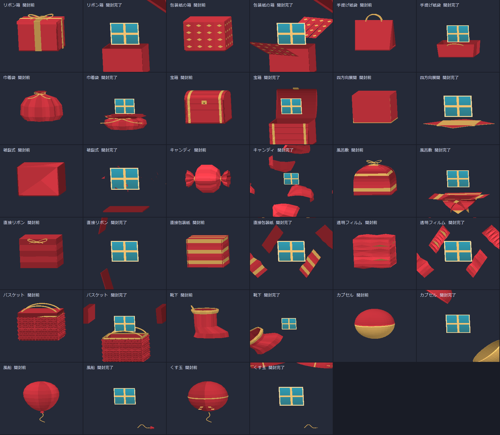

# プレゼント開封

AviUtl2 で、リボン付きの箱や宝箱を立体的に開き、中から好きな画像を見せるメディアオブジェクトです。17種類の包装と、紙吹雪や花火など11種類の付加演出を組み合わせられます。

[配布 ZIP をダウンロード](https://github.com/vramwiz/SYNC_GiftOpen/releases/latest/download/SYNC_GiftOpen.zip)

## インストール

1. 配布 ZIP を展開します。
2. 中の `SYNC_GiftOpen` フォルダーを、AviUtl2 のプラグインフォルダー `C:\ProgramData\aviutl2\Plugin` に置きます。

更新時は同じ場所へ上書きします。アンインストールする場合は配置した `SYNC_GiftOpen` フォルダーを削除します。

## 使い方

1. 「メディアオブジェクトを追加」の「SYNC」から「プレゼント開封」を配置します。
2. 「画像ファイル」で中身を指定し、「包装スタイル」を選びます。画像なしでも開封を確認できます。
3. 「開封前時間」「開封時間」と「付加演出スタイル」を設定します。初期設定では赤い箱に金色のリボンが付き、配置の1秒後に開封を始め、2秒後に紙吹雪が始まります。
4. 視点や光源を変える場合は、上位レイヤーにカメラ制御を置き、このオブジェクトを対象に含めます。

### 包装と付加演出の調整

| やりたいこと | 使う設定 |
| --- | --- |
| 包装の形や色を調整する | 包装幅・高さ・奥行き、色1・色2 |
| 開封前から中身を透かして見せる | 包装透明度。0で不透明、100で包装本体が透明 |
| 包装だけを移動・拡大する | 包装X・Y・Z、包装拡大率 |
| 付加演出だけを移動・拡大する | 付加演出X・Y・Z、付加演出拡大率 |
| 飛散や光の広がりを調整する | 付加演出範囲。量・時間・色も個別に調整可能 |
| 包装・画像・付加演出をまとめて配置する | AviUtl2 の標準描画で位置・回転・拡大率を調整 |

旧版の画像設定を読み込んだ場合は「旧画像設定を移行」で「画像ファイル」に引き継げます。

## ライセンス

本体は GPL-3.0-only、AviUtl2 SDK 由来の定義は MIT ライセンスです。[LICENSE](LICENSE) と [第三者ライセンス](THIRD_PARTY_NOTICES.md)
